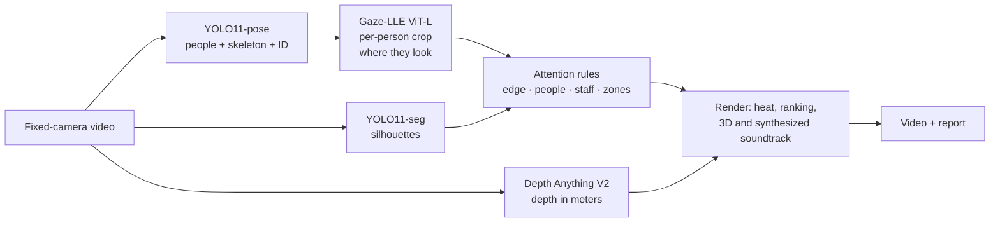

# BrandPose: where shoppers look, from an ordinary security camera

🌐 **English** · [Português (Brasil)](README.md)

> Personal project by **Claudio Escudero** ([linkedin.com/in/claudioescudero](https://www.linkedin.com/in/claudioescudero/)). Not a product.

The question behind the project: **can you estimate where each shopper looks in a store using only an ordinary security camera and open source AI models?**

The starting point was [this video about CactusXR (Auki)](https://www.instagram.com/reels/DdtEh0UhCZA/). In it, store cameras produce an attention heatmap over the shelves. This repository tries to reproduce the idea from scratch and documents the path, including what worked and what went wrong.

> 📹 **Video used in the demo:** [public demo of the ACTi E43A security camera in a US convenience store](https://www.youtube.com/watch?v=-1bRhYjw1qE) (YouTube, 60 s, 1080p, fixed camera). All processing below was done on this video. Footage © ACTi Corporation.

## Result

🎬 **Demo video (42 s):** [watch on YouTube](https://youtu.be/TMUM-IKHqCo) · [download from the release](https://github.com/escudero/brandpose/releases/latest)

[](https://youtu.be/TMUM-IKHqCo)

| Gaze estimated frame by frame | The scene in 3D (from a single image) | Attention report |
|---|---|---|
|  |  |  |

Over 60 s from a real security camera in a convenience store:

| Zone | Attention | % | People |
|---|---|---|---|
| Candy and chocolate | 16.1 s | 32% | 8 |
| Sunglasses and accessories | 15.8 s | 31% | 10 |
| Back-wall snacks | 7.2 s | 14% | 7 |
| Coffee and juice | 2.8 s | 5% | 6 |
| Endcap | 2.5 s | 5% | 2 |

That is 797 estimated gazes, 17 shoppers and 9 zones with attention. These numbers are **model estimates**, with no manual ground truth (see the limitations).

## How it works



1. **People:** YOLO11-pose finds each person, the 17 body keypoints and an ID that follows the person frame by frame (ByteTrack, on every frame).
2. **Gaze:** [Gaze-LLE](https://github.com/fkryan/gazelle) (CVPR 2025) takes a **square crop around each head** and returns a heatmap of where the person is looking, 10 times per second.
3. **Rules:** the gaze point is smoothed over time and assigned to a store zone. Gazes that are not shelf attention are discarded (see below).
4. **3D:** Depth Anything V2 estimates the depth of one frame, which becomes a point cloud of about 500 thousand points.
5. **Video:** OpenCV, NumPy and Pillow draw each frame, FFmpeg encodes it, and the soundtrack is synthesized in code.

Details of each stage, with libraries, versions, formats and timings, are in [`docs/arquitetura.md`](docs/arquitetura.md) (in Portuguese).

## What I learned along the way

| Finding | Evidence | What changed |
|---|---|---|
| Squeezing the whole frame into 448×448 blinds the model | A 58 px head reached the model at about 13×23 px | Per-person crop: head 3.5 times larger and undistorted |
| The tracker lost people when running at 3 frames per second | At t=24 s, 4 people were detected but only 2 tracked | Tracking on every frame |
| **Gaze leaving the image sticks to the edge** | 34% of peaks were less than 24 px from the edge | A peak less than 32 px from the edge counts as "out of frame" |
| **Gaze landing on other people became "shelf attention"** | 25% of gazes fell on someone's silhouette | A target on a person counts toward no zone |
| The same person got new IDs | Tracks restarting up to 1.5 s later, less than 150 px away | Fragments merged: 20 tracks became 17 shoppers |
| The camera lens is unknown | Minimizing the floor residual always picked the narrowest field of view | Field of view where the shelves stand at 90° to the floor: 60° |

Without the edge and people rules, the ranking showed "Sunglasses" with 77 s and 36%, a false result.

## Reproduce

Requirements: Python 3.13, FFmpeg, about 10 GB free. Tested on a Mac M2 Pro with 16 GB (MPS acceleration).

```bash
python3 -m venv .venv && .venv/bin/pip install -r requirements.txt

# source video (public demo of the ACTi E43A camera)
.venv/bin/yt-dlp -f "bv*[height<=1080][ext=mp4]+ba[ext=m4a]" \
    -o "data/videos/youtube/yt_%(id)s.%(ext)s" "https://www.youtube.com/watch?v=-1bRhYjw1qE"

# simple simulation (recommended settings)
cd scripts
../.venv/bin/python gaze_sim_v2.py ../data/videos/youtube/yt_-1bRhYjw1qE.mp4 ../outputs/v2 \
    --crop --model gazelle_dinov2_vitl14_inout --smooth 0.5 --suppress-self --track-every-frame --max-seconds 60
```

The step by step for the full video (extraction, zones, depth, render and soundtrack) is in [`docs/experiments/2026-10-14-promo-v2.md`](docs/experiments/2026-10-14-promo-v2.md) (in Portuguese). The zones drawn for this camera are in [`config/zones_acti.json`](config/zones_acti.json).

## Structure

```
scripts/
  gaze_sim.py          v1: Gaze-LLE on the whole frame
  gaze_sim_v2.py       v2: per-person crop, ViT-L, smoothing
  promo/               demo video pipeline
    extract_v2.py      pose, silhouettes and gaze per frame
    depth.py           metric depth + field of view
    render_promo.py    attention rules + video composition
    audio.py           synthesized soundtrack
config/zones_acti.json store zones (polygons)
docs/
  arquitetura.md       infrastructure, flow, libraries and licenses
  research.md          models, datasets and reference projects
  experiments/         one page per run, with numbers and learnings
data/videos/SOURCES.md source and license of each test video
```

Videos, extracted data and outputs are kept out of git (see `.gitignore`) and are generated locally.

## Limitations

- **No ground truth:** accuracy was not measured against manual annotations. Improvement between versions was judged by eye and through indirect metrics.
- **The 3D comes from a single image.** It is the surface seen from one viewpoint, so the virtual camera's orbit is small.
- The zones and the staff area were **drawn by hand** for this camera.
- **Not real time:** about 3 frames per second on an M2 Pro.

## Credits and licenses

- Video footage: public demo of the ACTi E43A camera, [on YouTube](https://www.youtube.com/watch?v=-1bRhYjw1qE). Footage © ACTi Corporation.
- [Gaze-LLE](https://github.com/fkryan/gazelle) (MIT) and [DINOv2](https://github.com/facebookresearch/dinov2) (Apache-2.0).
- [Ultralytics YOLO11](https://github.com/ultralytics/ultralytics) (**AGPL-3.0**).
- [Depth Anything V2](https://github.com/DepthAnything/Depth-Anything-V2) Metric Indoor Base (the Base weights are **CC-BY-NC-4.0**, non-commercial use).
- Full list in [`docs/arquitetura.md`](docs/arquitetura.md#8-licenças-e-direitos-atenção-para-uso-comercial) (in Portuguese).
