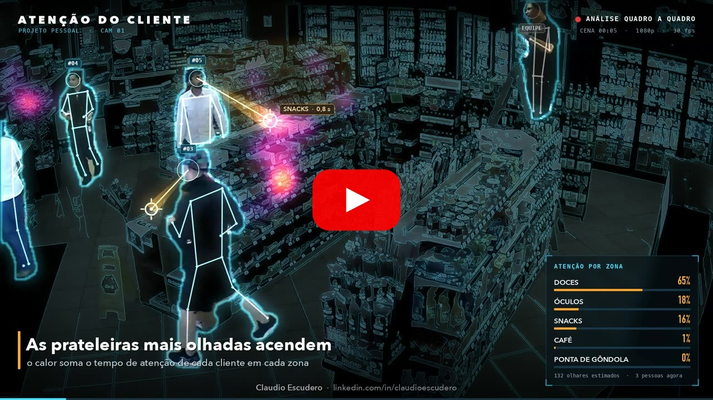
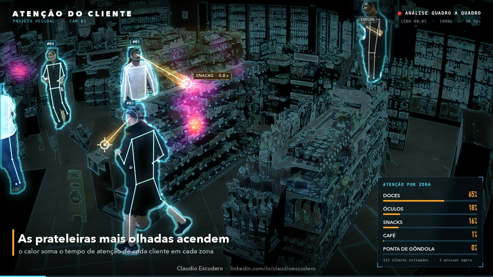
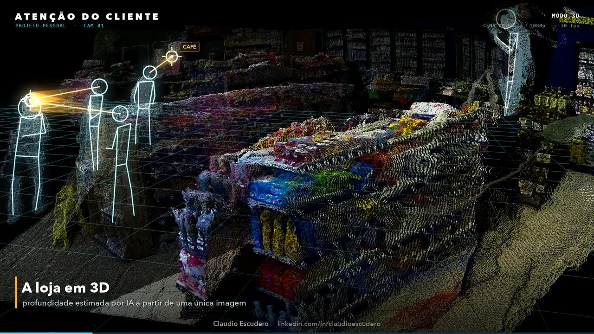
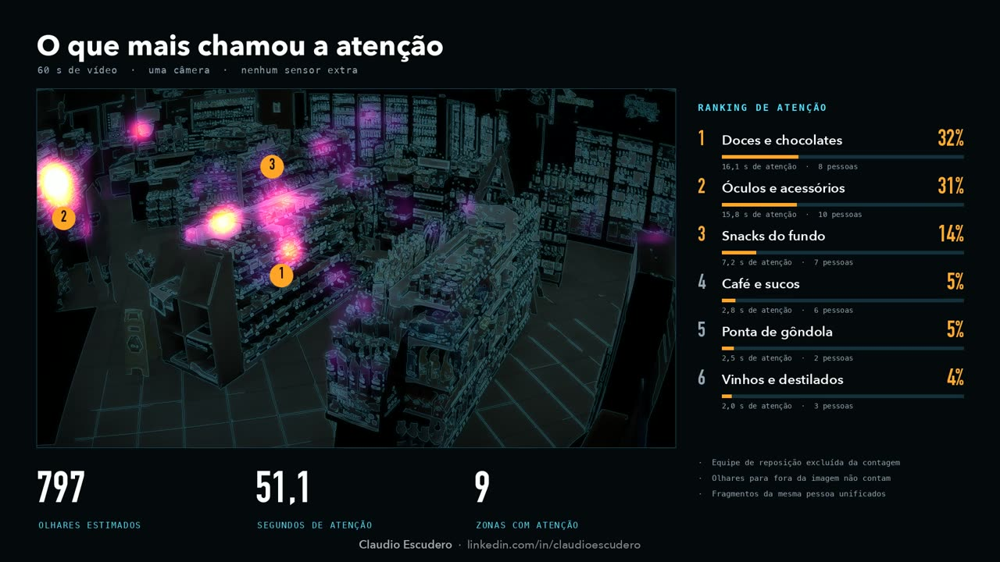
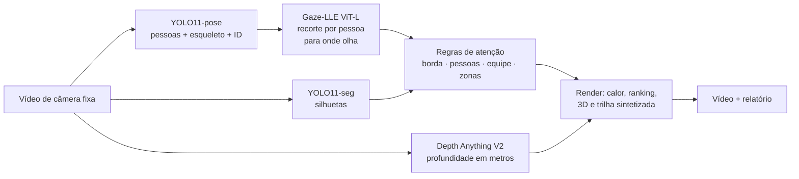

# BrandPose: para onde os clientes olham, com uma câmera de segurança comum

🌐 [English](README.en.md) · **Português (Brasil)**

> Projeto pessoal de **Claudio Escudero** ([linkedin.com/in/claudioescudero](https://www.linkedin.com/in/claudioescudero/)). Não é um produto.

A pergunta do projeto: **dá para estimar para onde cada cliente olha numa loja, usando só uma câmera de segurança comum e modelos de IA open source?**

O ponto de partida foi [este vídeo do CactusXR (Auki)](https://x.com/CactusXR/status/2103355813444321655). Nele, câmeras de loja geram um mapa de calor de atenção nas prateleiras. Este repositório tenta reproduzir a ideia do zero e documenta o caminho, com o que funcionou e o que deu errado.

> 📹 **Vídeo usado na demonstração:** [demonstração pública da câmera de segurança ACTi E43A numa loja de conveniência nos EUA](https://www.youtube.com/watch?v=-1bRhYjw1qE) (YouTube, 60 s, 1080p, câmera fixa). Todo o processamento abaixo foi feito sobre esse vídeo. As imagens são da ACTi Corporation.

## Resultado

🎬 **Vídeo de demonstração (42 s):** [assista no YouTube](https://youtu.be/TMUM-IKHqCo) · [baixe na release](https://github.com/escudero/brandpose/releases/latest)

[](https://youtu.be/TMUM-IKHqCo)

| Olhar estimado quadro a quadro | A cena em 3D (uma única imagem) | Relatório de atenção |
|---|---|---|
|  |  |  |

Em 60 s de uma câmera de segurança real numa loja de conveniência:

| Zona | Atenção | % | Pessoas |
|---|---|---|---|
| Doces e chocolates | 16,1 s | 32% | 8 |
| Óculos e acessórios | 15,8 s | 31% | 10 |
| Snacks do fundo | 7,2 s | 14% | 7 |
| Café e sucos | 2,8 s | 5% | 6 |
| Ponta de gôndola | 2,5 s | 5% | 2 |

São 797 olhares estimados, 17 clientes e 9 zonas com atenção. Esses números são **estimativas do modelo**, sem gabarito manual (veja as limitações).

## Como funciona



1. **Pessoas:** o YOLO11-pose acha cada pessoa, os 17 pontos do corpo e um ID que segue a pessoa quadro a quadro (ByteTrack, em todos os quadros).
2. **Olhar:** o [Gaze-LLE](https://github.com/fkryan/gazelle) (CVPR 2025) recebe um **recorte quadrado em volta de cada cabeça** e devolve um mapa de calor de para onde a pessoa olha, 10 vezes por segundo.
3. **Regras:** o ponto do olhar é suavizado no tempo e atribuído a uma zona da loja. Olhares que não são atenção em prateleira são descartados (veja abaixo).
4. **3D:** o Depth Anything V2 estima a profundidade de um quadro, que vira uma nuvem de pontos com cerca de 500 mil pontos.
5. **Vídeo:** OpenCV, NumPy e Pillow desenham cada quadro, o FFmpeg codifica, e a trilha sonora é sintetizada em código.

O detalhe de cada etapa, com bibliotecas, versões, formatos e tempos, está em [`docs/arquitetura.md`](docs/arquitetura.md).

## O que aprendi no caminho

| Descoberta | Evidência | O que mudou |
|---|---|---|
| Comprimir o quadro inteiro para 448×448 cega o modelo | A cabeça de 58 px chegava ao modelo com cerca de 13×23 px | Recorte por pessoa: cabeça 3,5 vezes maior e sem distorção |
| O rastreador perdia pessoas rodando a 3 quadros por segundo | Em t=24 s, havia 4 pessoas detectadas e só 2 rastreadas | Rastreamento em todos os quadros |
| **Olhar para fora da imagem gruda na borda** | 34% dos picos ficavam a menos de 24 px da borda | Pico a menos de 32 px da borda conta como "fora da imagem" |
| **Olhar sobre outras pessoas virava "atenção em prateleira"** | 25% dos olhares caíam sobre a silhueta de alguém | Alvo sobre uma pessoa não conta para nenhuma zona |
| A mesma pessoa ganhava IDs novos | Trilhas que recomeçavam até 1,5 s depois, a menos de 150 px | Fragmentos unificados: 20 trilhas viraram 17 clientes |
| A lente da câmera é desconhecida | Minimizar o resíduo do piso sempre escolhia o menor campo de visão | Campo de visão em que as gôndolas ficam a 90° do piso: 60° |

Sem as regras de borda e de pessoas, o ranking apontava "Óculos" com 77 s e 36%, um resultado falso.

## Reproduzir

Requisitos: Python 3.13, FFmpeg, cerca de 10 GB livres. Testado num Mac M2 Pro com 16 GB (aceleração MPS).

```bash
python3 -m venv .venv && .venv/bin/pip install -r requirements.txt

# vídeo de origem (demonstração pública da câmera ACTi E43A)
.venv/bin/yt-dlp -f "bv*[height<=1080][ext=mp4]+ba[ext=m4a]" \
    -o "data/videos/youtube/yt_%(id)s.%(ext)s" "https://www.youtube.com/watch?v=-1bRhYjw1qE"

# simulação simples (configuração recomendada)
cd scripts
../.venv/bin/python gaze_sim_v2.py ../data/videos/youtube/yt_-1bRhYjw1qE.mp4 ../outputs/v2 \
    --crop --model gazelle_dinov2_vitl14_inout --smooth 0.5 --suppress-self --track-every-frame --max-seconds 60
```

O vídeo completo (extração, zonas, profundidade, render e trilha) tem o passo a passo em [`docs/experiments/2026-10-14-promo-v2.md`](docs/experiments/2026-10-14-promo-v2.md). As zonas desenhadas para essa câmera estão em [`config/zones_acti.json`](config/zones_acti.json).

## Estrutura

```
scripts/
  gaze_sim.py          v1: Gaze-LLE no quadro inteiro
  gaze_sim_v2.py       v2: recorte por pessoa, ViT-L, suavização
  promo/               pipeline do vídeo de demonstração
    extract_v2.py      pose, silhuetas e olhar por quadro
    depth.py           profundidade métrica + campo de visão
    render_promo.py    regras de atenção + composição do vídeo
    audio.py           trilha sonora sintetizada
config/zones_acti.json zonas da loja (polígonos)
docs/
  arquitetura.md       infraestrutura, fluxo, bibliotecas e licenças
  research.md          modelos, datasets e projetos de referência
  experiments/         uma página por rodada, com números e aprendizados
data/videos/SOURCES.md fonte e licença de cada vídeo de teste
```

Os vídeos, os dados extraídos e as saídas ficam fora do git (veja `.gitignore`) e são gerados localmente.

## Limitações

- **Sem gabarito:** a acurácia não foi medida contra anotações manuais. A melhora entre versões foi avaliada a olho e por métricas indiretas.
- **O 3D vem de uma única imagem.** É a superfície vista de um ponto só, por isso a órbita da câmera virtual é pequena.
- As zonas e a região da equipe foram **desenhadas à mão** para esta câmera.
- **Não é tempo real:** cerca de 3 quadros por segundo num M2 Pro.

## Créditos e licenças

O código do BrandPose está sob a [licença MIT](LICENSE). As bibliotecas, os pesos dos modelos e as imagens de terceiros mantêm as próprias licenças, listadas em [`THIRD_PARTY_NOTICES.md`](THIRD_PARTY_NOTICES.md).

- Imagens do vídeo: demonstração pública da câmera ACTi E43A, [no YouTube](https://www.youtube.com/watch?v=-1bRhYjw1qE). Os direitos das imagens são da ACTi Corporation.
- [Gaze-LLE](https://github.com/fkryan/gazelle) (MIT) e [DINOv2](https://github.com/facebookresearch/dinov2) (Apache-2.0).
- [Ultralytics YOLO11](https://github.com/ultralytics/ultralytics) (**AGPL-3.0**).
- [Depth Anything V2](https://github.com/DepthAnything/Depth-Anything-V2) Metric Indoor Base (os pesos Base são **CC-BY-NC-4.0**, uso não comercial).
- Lista completa em [`docs/arquitetura.md`](docs/arquitetura.md#8-licenças-e-direitos-atenção-para-uso-comercial).
