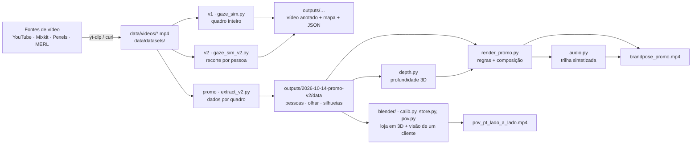
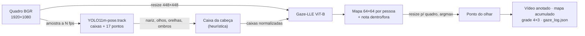
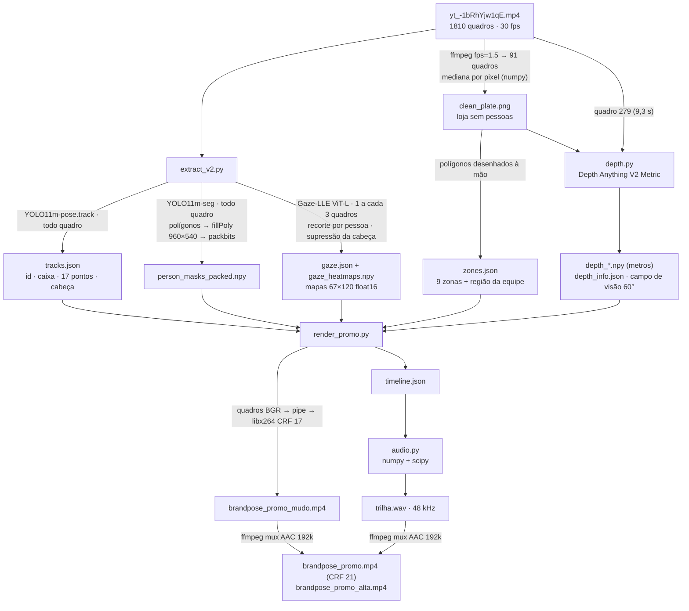
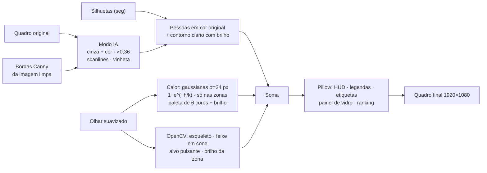
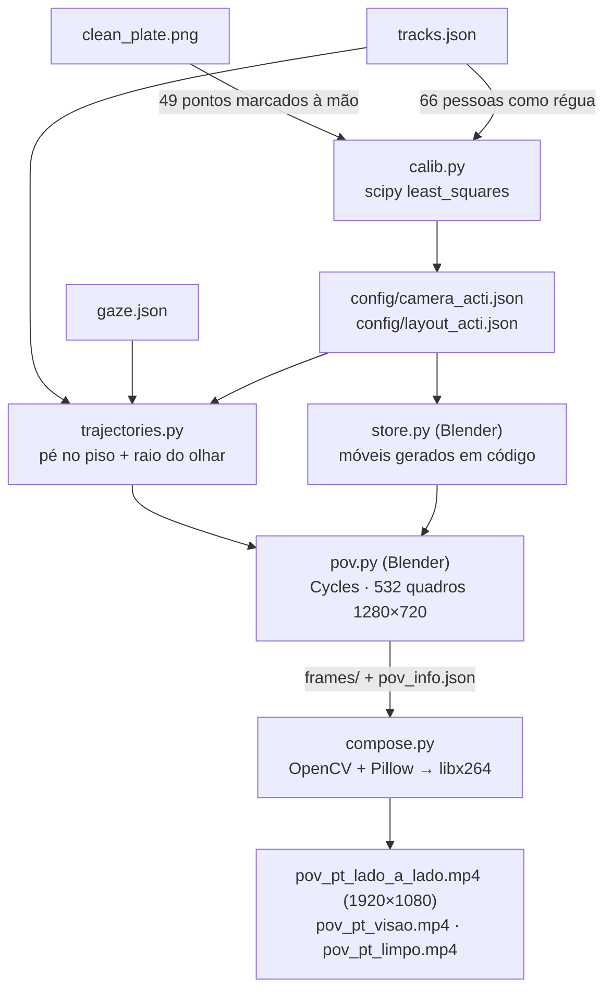

# Arquitetura do BrandPose: infraestrutura, fluxo e bibliotecas

Este documento descreve onde o estudo roda, que bibliotecas e modelos usa e como cada etapa transforma os dados, do vídeo bruto ao relatório, ao vídeo promocional e à loja em 3D. Estado em 18/10/2026.

Os resultados de cada rodada estão em `docs/experiments/`. As referências e alternativas estão em `docs/research.md`.

## 1. Visão geral



Em uma frase: **YOLO11** acha e acompanha as pessoas, **Gaze-LLE** estima para onde cada uma olha, regras próprias transformam isso em atenção por zona, e **OpenCV/NumPy/Pillow** desenham o resultado, que o **FFmpeg** codifica.

## 2. Infraestrutura

| Item | Valor |
|---|---|
| Máquina | Mac com Apple M2 Pro e 16 GB de RAM |
| Aceleração | PyTorch com **MPS** (Metal). Sem GPU NVIDIA e sem nuvem |
| Python | 3.13.14, num ambiente virtual em `.venv/` |
| Instalação de pacotes | `pip install -r requirements.txt` |
| FFmpeg | 7.1 (Homebrew), externo ao Python. Extrai quadros e codifica H.264 (libx264) e AAC |
| Cache de modelos | `~/.cache/torch/hub` (1,7 GB): código e pesos do Gaze-LLE e do DINOv2. `~/.cache/huggingface` (2,6 GB): inclui o Depth Anything V2 |
| Pesos do YOLO | `yolo11m-pose.pt` e `yolo11m-seg.pt`, baixados pela Ultralytics para o diretório de onde o script roda (`scripts/` e `scripts/promo/`) |
| Restrição prática | **Um processo pesado por vez.** Com 16 GB, modelos rodando em paralelo travam a máquina |

### Estrutura de pastas

```
BrandPose/
├── scripts/
│   ├── gaze_sim.py           # v1: Gaze-LLE no quadro inteiro
│   ├── gaze_sim_v2.py        # v2: recorte por pessoa, ViT-L, suavização
│   ├── promo/
│   │   ├── extract_v2.py     # dados por quadro (pose, silhueta, olhar)
│   │   ├── depth.py          # profundidade métrica + campo de visão
│   │   ├── render_promo.py   # regras de atenção + composição do vídeo
│   │   └── audio.py          # trilha sonora sintetizada
│   └── blender/              # loja em 3D e a visão de um cliente (seção 5.5)
│       ├── calib.py          # câmera + móveis ajustados aos cantos marcados
│       ├── layout.py         # planta, zonas e geometria dos móveis
│       ├── overlay.py        # móveis ajustados sobre a foto (conferência)
│       ├── trajectories.py   # pé e raio do olhar por pessoa e quadro
│       ├── store.py          # monta a loja no Blender e renderiza vistas
│       ├── warp.py           # aplica a lente ao render, para comparar com a foto
│       ├── pov.py            # câmera subjetiva de um cliente
│       ├── compose.py        # vídeos lado a lado e da visão dele
│       ├── shots.py          # tomadas 3D do vídeo para o LinkedIn
│       ├── promo.py          # vídeo vertical para o LinkedIn (4:5)
│       └── promo_audio.py    # trilha sintetizada do vídeo para o LinkedIn
├── config/                   # zonas, câmera calibrada e móveis da cena da ACTi
├── data/
│   ├── videos/               # vídeos de base (SOURCES.md com fonte e licença)
│   └── datasets/             # MERL Shopping
├── outputs/<data>-<nome>/    # uma pasta por rodada (histórico)
└── docs/                     # research.md, experiments/, este arquivo
```

## 3. Bibliotecas

Versões instaladas em `.venv` (fixadas em `requirements.txt`).

| Biblioteca | Versão | Para que serve aqui | Onde | Licença |
|---|---|---|---|---|
| **torch** | 2.14.1 | Executa os modelos no MPS | todos os scripts de IA | BSD-3 |
| **torchvision** | 0.29.1 | Dependência da Ultralytics e das transformações do Gaze-LLE | indireto | BSD-3 |
| **ultralytics** | 8.4.177 | YOLO11 pose e segmentação, e rastreamento (ByteTrack) | `gaze_sim*.py`, `extract_v2.py` | **AGPL-3.0** |
| **lap** | 0.5.13 | Associação de detecções no rastreador | indireto (ByteTrack) | BSD-2 |
| **timm** | 1.0.30 | Blocos de transformer usados pelo Gaze-LLE | indireto (torch.hub) | Apache-2.0 |
| **scikit-learn** | 1.9.1 | Importado pelo código do Gaze-LLE (métricas); não usamos diretamente | indireto | BSD-3 |
| **transformers** | 5.19.0 | Carrega e roda o Depth Anything V2 | `depth.py` | Apache-2.0 |
| **opencv-python** | 5.0.0.93 | Leitura de vídeo, redimensionamento, desfoque, Canny, desenho, rotação (Rodrigues) | todos | Apache-2.0 |
| **numpy** | 2.5.4 | Arrays, mapas de calor, nuvem de pontos e z-buffer | todos | BSD-3 |
| **scipy** | 1.18.1 | Distância às zonas (`ndimage`), filtros e reverberação do áudio, WAV, ajuste da câmera (`least_squares`) | `render_promo.py`, `audio.py`, `calib.py` | BSD-3 |
| **pillow** | 12.3.0 | Recortes para o Gaze-LLE e texto e interface do vídeo | todos | MIT-CMU |
| **yt-dlp** | 2026.8.19 | Baixa os vídeos do YouTube e do Instagram | aquisição | Unlicense |
| **FFmpeg** (binário) | 7.1 | Mediana da imagem limpa, codificação H.264, mux do áudio AAC | shell, `render_promo.py` e `compose.py` | LGPL/GPL (libx264 é GPL) |
| **Blender** (aplicativo) | 5.2.2 LTS | Monta a loja em 3D e renderiza com o Cycles na GPU (Metal). Roda os scripts com o Python dele, que traz o NumPy | `store.py`, `pov.py` | GPL-2.0-or-later |

`huggingface_hub`, `safetensors` e `tokenizers` vêm junto com o `transformers`.

## 4. Modelos

| Modelo | Tarefa | Entrada → saída | Onde | Licença |
|---|---|---|---|---|
| **YOLO11m-pose** (Ultralytics) | Pessoas, 17 pontos do corpo (COCO) e IDs com ByteTrack | quadro BGR → caixas, pontos e confianças, ID por pessoa | v1, v2, promo | AGPL-3.0 |
| **YOLO11m-seg** (Ultralytics) | Silhueta das pessoas | quadro → polígonos por pessoa | promo | AGPL-3.0 |
| **Gaze-LLE** `gazelle_dinov2_vitb14_inout` | Alvo do olhar (v1) | imagem 448×448 + caixas das cabeças normalizadas → mapa 64×64 por pessoa + nota "dentro do quadro" | v1 | MIT |
| **Gaze-LLE** `gazelle_dinov2_vitl14_inout` | Alvo do olhar (v2 e promo) | igual, com backbone maior | v2, promo | MIT |
| **DINOv2** ViT-B/14 e ViT-L/14 | Backbone congelado do Gaze-LLE (via `torch.hub`) | imagem → características | indireto | Apache-2.0 |
| **Depth Anything V2 Metric Indoor Base** | Profundidade em metros | imagem → mapa de profundidade | `depth.py` | **Não declarada** no card. Deriva do Base, que é **CC-BY-NC-4.0**: trate como não comercial |

## 5. Fluxo das transformações

### 5.1 Aquisição

| Origem | Ferramenta | Resultado |
|---|---|---|
| YouTube e Instagram | `yt-dlp` (melhor vídeo mp4 até 1080p + áudio m4a, depois mux) | `data/videos/youtube/yt_<id>.mp4` + `.info.json` |
| Mixkit e Pexels | `curl` na URL direta do arquivo | `data/videos/mix_*.mp4`, `px_*.mp4` |
| MERL Shopping | `curl` do zip (1,8 GB) + `unzip` de vídeos escolhidos | `data/datasets/merl_shopping/videos/` |

### 5.2 v1: `gaze_sim.py` (Gaze-LLE no quadro inteiro)



Problema que levou à v2: com o quadro inteiro espremido para 448×448, uma cabeça de 58 px chega ao modelo com cerca de 13×23 px.

### 5.3 v2: `gaze_sim_v2.py` (configuração recomendada)

Mudanças sobre a v1:

1. O **rastreamento roda em todos os quadros** (`--track-every-frame`). O olhar continua só nos quadros amostrados.
2. **Recorte por pessoa** (`--crop`): um quadrado com lado entre 10 cabeças e o tamanho da imagem (mínimo de 448 px), com a cabeça no terço de cima. Todos os recortes vão juntos ao modelo, num lote `[N, 3, 448, 448]`.
3. O mapa 64×64 de cada recorte é **reposicionado no quadro inteiro**.
4. **Suavização no tempo** por pessoa (`--smooth 0.5`, em 1/8 da resolução). Reinicia se a pessoa sumir por mais de 1 s.
5. **Supressão da própria cabeça** (ampliada 1,5×) antes do argmax (`--suppress-self`).
6. Métricas extras: % do olhar na própria cabeça e oscilação do ponto entre amostras.

### 5.4 Vídeo promocional: `scripts/promo/`



#### Etapa 1: imagem limpa
A mediana de 91 quadros (1,5 por segundo) apaga quem passa pela cena. Essa imagem é o fundo do relatório, a base para desenhar as zonas e a fonte das bordas (Canny) do visual "modo IA".

#### Etapa 2: `extract_v2.py`, dados por quadro
| Saída | Transformação |
|---|---|
| `tracks.json` | YOLO11m-pose + ByteTrack em todos os 1.810 quadros. Para cada pessoa: ID, caixa, 17 pontos, confianças e caixa da cabeça (`head_box` da v2) |
| `person_masks_packed.npy` | YOLO11m-seg. Os polígonos de todas as pessoas são preenchidos numa máscara 960×540 e compactados em bits (1.810 × 64.800 bytes) |
| `gaze.json` | A cada 3 quadros (10 por segundo): recorte por pessoa, Gaze-LLE ViT-L, mapa reposicionado em 1/16, própria cabeça zerada, pico. Registro: quadro, ID, nota dentro/fora, ponto, pico e índice do mapa |
| `gaze_heatmaps.npy` | Os mapas 67×120 (float16), para suavizar depois sem rodar o modelo de novo |
| `meta.json` | Resolução, fps, modelo e parâmetros de recorte |

#### Etapa 3: zonas
Nove polígonos em `zones.json`, no sistema de coordenadas 1920×1080, mais o retângulo `staff_heads`: a região onde fica a cabeça de quem está na escada (reposição).

#### Etapa 4: `depth.py`, profundidade e campo de visão
1. `transformers` (`AutoImageProcessor` + `AutoModelForDepthEstimation`) gera a profundidade em metros. Ela é ampliada (bicúbica) para 1080×1920, para o quadro congelado e para a imagem limpa.
2. **O campo de visão da lente é desconhecido.** Para cada valor entre 50° e 120°, os pixels de piso e das faces das gôndolas DOCES e MERCEARIA são projetados em 3D (câmera pinhole) e recebem um plano por RANSAC. Fica o campo de visão em que as faces ficam mais perto de **90° do piso**: 60°, com erro de 2,5°.
3. `depth_info.json` guarda o campo de visão, a normal e a distância do piso.

#### Etapa 5: `render_promo.py`, regras e composição

**Regras sobre os dados** (classe `Data`):

| Regra | Transformação | Por quê |
|---|---|---|
| Suavização do olhar | Média dos mapas vizinhos (0,25 / 0,5 / 0,25), sem a própria cabeça, pico refinado pelo centroide 3×3, posições suavizadas 1-2-3-2-1 e interpolação linear para 30 fps | Feixes estáveis |
| **Borda = fora da imagem** | Pico a menos de 32 px da borda zera a nota dentro/fora | 34% dos picos colavam na borda quando o alvo estava fora do quadro |
| **Olhar sobre pessoas** | Alvo sobre a silhueta (raio de 4 px em meia resolução) não conta para nenhuma zona | 25% dos olhares caíam sobre outras pessoas |
| Zona do olhar | Mapa de rótulos em 1/4 da resolução. Pontos fora de zona herdam a zona mais próxima a até 40 px (`scipy.ndimage.distance_transform_edt`) | Tolerância à imprecisão do ponto |
| Equipe | Cabeça mediana da trilha dentro de `staff_heads` vira "EQUIPE" e sai das métricas | O repositor não é cliente |
| **Fragmentos** | Trilha que começa até 1,5 s e 150 px depois do fim de outra é a mesma pessoa. Clientes renumerados por ordem de chegada | 20 trilhas, 17 clientes |
| Estatísticas | Cada amostra vale 0,1 s. Acumula segundos por zona por quadro, pessoas distintas por zona e total de olhares | Ranking ao vivo e relatório |

**Camadas de cada quadro** (`Heat`, `Scene`, `Cloud`):



**Cena 3D** (classe `Cloud`), a partir do quadro congelado:
1. **Retroprojeção pinhole** com campo de visão de 60°, a cada 2 pixels: cerca de 498 mil pontos.
2. **Limpeza:** remove pontos "voadores", com descontinuidade relativa de profundidade acima de 4,5%.
3. **Cor:** saturação +25%, pessoas tingidas de ciano-branco e calor somado.
4. **Câmera virtual:** gira em torno de um pivô a 4,96 m, com rotação vertical pela normal do piso e horizontal pelo eixo lateral (`cv2.Rodrigues`), mais aproximação. A trajetória é uma curva Catmull-Rom pelos pontos de vista (0°, 0°, 1,0) → (-16°, +10°, 0,86) → (+13°, -5°, 0,90) → (0°, 0°, 1,0). A órbita é moderada porque a profundidade vem de uma única imagem.
5. **Rasterização:** projeção e z-buffer com `np.minimum.at`. O tamanho do ponto é proporcional a passo × profundidade original ÷ profundidade atual, e um fator de encolhimento revela a textura de pontos.
6. **Extras:** grade no plano do piso, esqueleto e feixes de olhar em 3D (pontos e alvos projetados com a profundidade local).

**Linha do tempo** (classe `Timeline`): ela mapeia o tempo de saída para o tempo do vídeo de origem. As cenas são câmera crua (5,2 s), varredura (2 s), rebobinar (0,8 s, de 7,2 s até 0), ao vivo (9,3 s), 3D congelado (10 s), avanço rápido (6 s, de 9,3 s até 60,3 s) e relatório e encerramento (11 s).

**Codificação:** cada quadro BGR vai por pipe ao `ffmpeg` (rawvideo → libx264 CRF 17, yuv420p, faststart).

#### Etapa 6: `audio.py`, trilha sonora
Tudo é sintetizado com NumPy e SciPy e sincronizado pelo `timeline.json`: pads aditivos com filtro passa-baixa, bumbo (seno com queda de frequência), chimbal (ruído passa-alta), risers (ruído filtrado em camadas), impacto, sinos, notas e som de rebobinar. Depois vem uma reverberação por convolução com ruído decaindo, compressão lateral pelo bumbo, saturação suave (tanh) e pico em -1 dBFS. Sai em WAV de 48 kHz, 16 bits, estéreo.

#### Etapa 7: mux
O `ffmpeg` junta o vídeo e o AAC de 192 kbps. Saem duas versões: cópia do vídeo em qualidade máxima (`_alta`) e uma recodificada com CRF 21 (versão padrão).

### 5.5 Loja em 3D e visão de um cliente: `scripts/blender/`

A loja é modelada no Blender sobre uma câmera calibrada, e uma câmera subjetiva refaz o que um cliente via. Parte dos dados do `extract_v2.py`. O método, os números e os comandos estão em `docs/experiments/2026-10-18-blender-pov.md`.



| Etapa | Transformação |
|---|---|
| `calib.py` | Câmera (altura, giro, inclinação, rolagem, distância focal e distorção radial k1) ajustada junto com as caixas de 13 móveis e as posições de 66 pessoas, com o nariz 1,49 m acima dos tornozelos. Resultado: câmera a 2,68 m, 57° de campo de visão e k1 = −0,318 |
| `trajectories.py` | Para cada pessoa e quadro: pé no piso (tornozelos, nariz, centro da cabeça ou ombros, nessa ordem) e raio do olhar pelo pico do Gaze-LLE. Junta os números trocados pelo rastreador |
| `store.py` | Gera os móveis em código (prateleiras, produtos, garrafas), uma placa por zona e o calor no piso. Renderiza a vista da CCTV (sem distorção), órbita, corredor e planta |
| `warp.py` | Aplica a distorção da lente ao render da CCTV (`cv2.remap`), para comparar pixel a pixel com a foto |
| `pov.py` | Câmera nos olhos do cliente: trajeto suavizado e afastado dos móveis, direção pelo olhar em 3D (raio da CCTV até a cena) e loja fechada com teto e vitrine. Cycles com 32 amostras e denoise |
| `compose.py` | Lado a lado com a CCTV (linha do olhar projetada de volta pela câmera calibrada), visão com mira e nome da zona olhada, e visão limpa |
| `shots.py` | Abre o `pov.blend` e renderiza em pé (1080×1350) as tomadas do vídeo para o LinkedIn: com o tempo congelado, a vista da CCTV e o voo até os olhos dele (165 quadros); depois a visão dele (336 quadros) e o mapa sem teto com o caminho e os olhares (225 quadros) |
| `promo.py` | Vídeo vertical 4:5 (1080×1350) em sete cenas, em tela cheia e com texto grande por cima, para tocar sem som. Pillow para os textos, OpenCV para as transições (cortina, zoom, fusões) |
| `promo_audio.py` | Trilha com os sintetizadores do `audio.py` num arranjo novo, sincronizada pelo `promo_pt_timeline.json`, e mux AAC com o `ffmpeg` |

## 6. Formatos de dados

| Arquivo | Formato | Conteúdo |
|---|---|---|
| `tracks.json` | Lista por quadro de `{id, box[4], kp[17][2], kc[17], head[4] ou null}` | Pessoas por quadro |
| `gaze.json` | Lista de `{frame, id, inout, xy[2], peak, hm}` | Olhar a 10 por segundo |
| `gaze_heatmaps.npy` | `float16 [N, 67, 120]` | Mapa de cada registro de olhar (1/16 da resolução) |
| `person_masks_packed.npy` | `uint8 [1810, 64800]` (`np.packbits` de 540×960) | União das silhuetas por quadro |
| `zones.json` | `{zones: [{name, short, polys}], staff_heads}` | Zonas da cena |
| `depth_*.npy` | `float32 [1080, 1920]`, em metros | Profundidade |
| `depth_info.json` | Campo de visão, normal e distância do piso, erro por campo de visão | Geometria da câmera |
| `timeline.json` | Lista `[cena, início, fim]` | Sincronia da trilha |
| `gaze_log.json` e `summary.json` (v1/v2) | Registro por pessoa e quadro, e totais | Saídas dos simuladores |
| `config/camera_acti.json` | `{h, yaw, pitch, roll, f, k1, M[3][3]}` (metros, radianos, pixels) | Câmera calibrada. `M` tem os eixos direita, baixo e frente da câmera no mundo |
| `config/layout_acti.json` | `{zona: {x, y, a, L, d, H}}` (metros e graus) | Caixa de cada móvel: início da face, direção, comprimento, profundidade e altura |
| `trajectories.json` | `{fps, people: {id: [{frame, feet[2], src, gaze_ray[3], gaze_xy[2]}]}}` | Pé no piso e raio do olhar (quando há) por pessoa e quadro |
| `pov_info.json` | Lista de `{frame, eye[3], target[3], zone}` | Olho, alvo e zona olhada da câmera subjetiva |

## 7. Tempos medidos (M2 Pro, MPS)

| Etapa | Escopo | Tempo |
|---|---|---|
| v1 (`gaze_sim.py`) | 60 s de vídeo, olhar a 3 por segundo | 42 s |
| v2 B (recorte, ViT-B) | idem | 60 s |
| v2 D (recorte, ViT-L, suavização) | idem | 121 s |
| v2 E (D + rastreamento em todos os quadros) | idem | 206 s |
| `extract_v2.py` | 1.810 quadros: pose + silhueta todo quadro, olhar a 10 por segundo | 518 s (0,29 s/quadro) |
| `render_promo.py` | 1.329 quadros de saída (44,3 s) | 185 s |
| `audio.py` | 44,3 s de áudio | 4 s |
| `calib.py` | 13 móveis e 66 pessoas, partindo da calibração atual | 25 s (do zero: 43 min, e cai num mínimo local pior) |
| `trajectories.py` | 1.810 quadros, todas as pessoas | 1 s |
| `store.py` | 4 vistas, Cycles com 160 amostras na GPU (Metal) | 2 min 18 s |
| `pov.py` | 532 quadros de 1280×720, Cycles com 32 amostras na GPU (Metal) | 71 min (8 s/quadro) |
| `compose.py` | 532 quadros, três vídeos | 35 s |
| `shots.py` | 1 quadro da CCTV + 187 do voo + 336 da visão + 225 do mapa, em 1080×1350, Cycles com 32 amostras na GPU (Metal) | 132 min (11 s/quadro) |
| `promo.py` + `promo_audio.py` | 1.139 quadros de 1080×1350 e a trilha | 88 s |

## 8. Licenças e direitos (atenção para uso comercial)

| Item | Situação |
|---|---|
| Ultralytics YOLO11 | **AGPL-3.0**: uso em produto fechado exige licença comercial da Ultralytics ou trocar o detector |
| Depth Anything V2 Metric Indoor **Base** | Não declarada. Os pesos Base são **CC-BY-NC-4.0** (não comercial). A variante **Small** é Apache-2.0 |
| Gaze-LLE, DINOv2, PyTorch, OpenCV, NumPy, SciPy, transformers, timm | Permissivas (MIT, Apache-2.0, BSD) |
| Vídeo da ACTi (YouTube) | Copyright da ACTi. Só para estudo local |
| Blender | GPL-2.0-or-later. `store.py` e `pov.py` rodam dentro dele e usam a API Python (`bpy`). O Blender não é distribuído aqui, e a licença MIT é compatível com a GPL |
| MERL Shopping | Pesquisa e educação |
| Mixkit e Pexels | Licenças gratuitas dos sites (veja `data/videos/SOURCES.md`) |
| Fontes do vídeo (Avenir Next, Menlo, DIN Condensed) | Fontes do sistema macOS. Para peça comercial, confirme a licença de uso em vídeo |
| Trilha sonora | Original, sintetizada pelo `audio.py` |

## 9. Como reproduzir

```bash
python3 -m venv .venv
.venv/bin/pip install -r requirements.txt

# v2 (configuração recomendada)
cd scripts
../.venv/bin/python gaze_sim_v2.py VIDEO SAIDA --crop --model gazelle_dinov2_vitl14_inout \
    --smooth 0.5 --suppress-self --track-every-frame --fps 3 --max-seconds 60

# vídeo promocional
cd promo
D=../../outputs/2026-10-14-promo-v2
../../.venv/bin/python extract_v2.py VIDEO $D/data --gaze-every 3
../../.venv/bin/python depth.py $D/data --frame 279
../../.venv/bin/python render_promo.py $D/data $D/brandpose_promo_mudo.mp4 --freeze 9.3
../../.venv/bin/python audio.py $D/timeline.json $D/trilha.wav
ffmpeg -i $D/brandpose_promo_mudo.mp4 -i $D/trilha.wav -map 0:v -map 1:a \
    -c:v libx264 -preset slow -crf 21 -pix_fmt yuv420p -c:a aac -b:a 192k -shortest $D/brandpose_promo.mp4
```

A imagem limpa (`clean_plate.png`) é gerada antes do `depth.py`, com a mediana de `ffmpeg -vf fps=1.5`. Os passos estão em `docs/experiments/2026-10-14-promo-v2.md`.

A loja em 3D e a visão do cliente (Blender 5.2), a partir da raiz do repositório:

```bash
D=outputs/2026-10-14-promo-v2/data
R=outputs/2026-10-18-blender-pov
BLENDER=/Applications/Blender.app/Contents/MacOS/Blender
.venv/bin/python scripts/blender/trajectories.py $D $R
$BLENDER -b --python scripts/blender/store.py -- $R
$BLENDER -b --python scripts/blender/pov.py -- $R
.venv/bin/python scripts/blender/compose.py $D $R
```

A calibração já está em `config/`. Os passos opcionais (refazer a calibração e conferir com a foto) estão em `docs/experiments/2026-10-18-blender-pov.md`.
