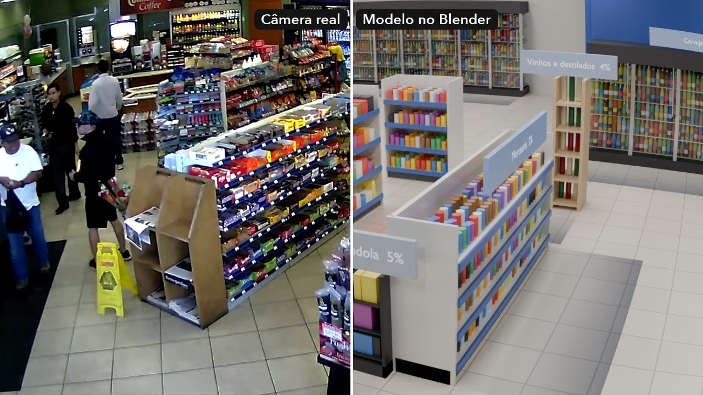
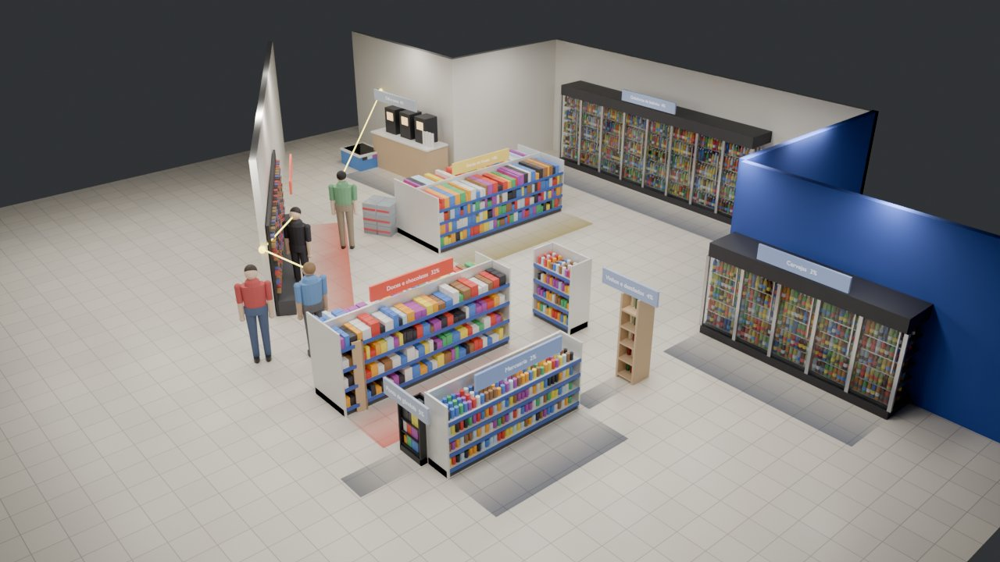
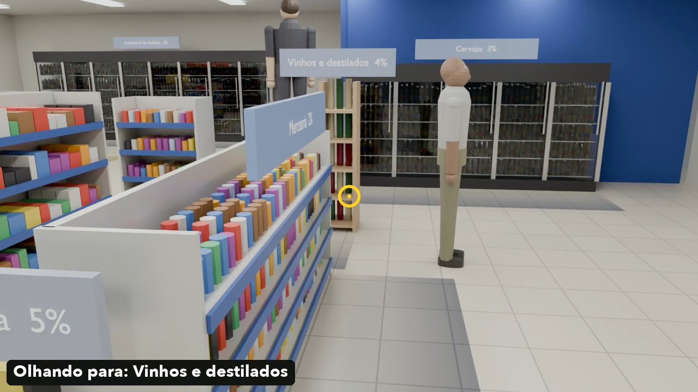
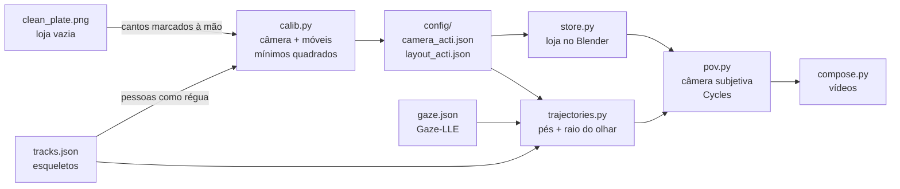
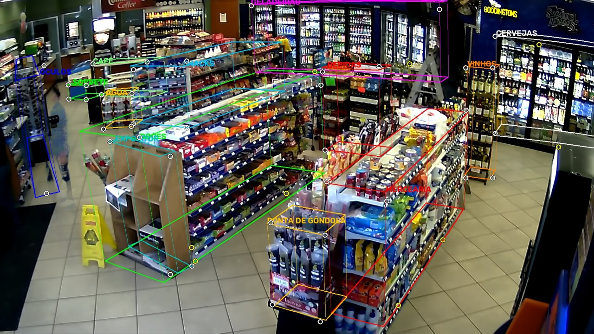

# 2026-10-18: a loja em 3D no Blender e a visão de um cliente

A pergunta era se dava para ver a loja **pelos olhos de um cliente**, usando só os dados que o pipeline já extrai da câmera de segurança: pessoas rastreadas quadro a quadro e o olhar estimado pelo Gaze-LLE. O escolhido foi o rapaz de jaqueta azul que entra aos 17,3 s do vídeo da ACTi. A loja foi modelada no Blender sobre uma câmera calibrada, e a câmera dele anda pelo trajeto estimado, virada para onde o olhar aponta.

Os scripts estão em `scripts/blender/`. A câmera e os móveis calibrados estão em `config/camera_acti.json` e `config/layout_acti.json`. Os resultados estão em `outputs/2026-10-18-blender-pov/`, e o vídeo final está no YouTube: [em português](https://youtu.be/ABeKpyzMcf8) e [em inglês](https://youtu.be/iE7DxHnahjM).

| Câmera real e modelo 3D, pela mesma câmera calibrada | A loja modelada no Blender | A visão dele, quadro a quadro |
|---|---|---|
|  |  |  |

## Por que não usar a profundidade direto

O vídeo de demonstração já tinha um 3D: a profundidade do Depth Anything V2 virando nuvem de pontos (`depth.py` e `render_promo.py`). Dois caminhos a partir dela foram testados e descartados:

1. **Malha com textura:** a profundidade vira uma superfície contínua, com a foto da loja vazia por cima. Vista de outro ângulo, a superfície estica e liga a frente de cada objeto ao fundo atrás dele. Para andar dentro da loja, não serve.
2. **Caixas posicionadas pela profundidade:** dois cliques na face de cada móvel, com a distância tirada do mapa de profundidade. A escala do mapa estava errada: medidas nele, as gôndolas tinham de 0,7 a 1,0 m de altura, e a câmera ficava a 2,04 m do piso.

A saída foi **modelar à mão sobre uma câmera calibrada**, com as medidas tiradas da própria imagem.

## Estratégia



### 1. Calibração: câmera e móveis juntos

Cada móvel é uma caixa: início da face visível (x, y), direção, comprimento, profundidade e altura. Na imagem da loja vazia, marquei à mão 49 pontos em 13 móveis: 40 cantos e 9 pontos que caem sobre uma aresta (a base de uma gôndola, por exemplo). Para cada móvel, só os parâmetros que esses pontos determinam ficam livres. Os outros vêm da planta inicial em `layout.py`.

A câmera tem seis parâmetros: altura, giro, inclinação, rolagem, distância focal e distorção radial da lente (k1). A escala vem das **pessoas**: em 66 amostras de corpo inteiro (a cada 20 quadros), o modelo supõe o nariz 1,49 m acima dos tornozelos, o de uma pessoa de cerca de 1,70 m. Câmera, móveis e as posições dessas pessoas são ajustados juntos, por mínimos quadrados (`scipy.optimize.least_squares`, perda soft L1).

| Parâmetro | Profundidade (`depth.py`) | Calibração (`calib.py`) |
|---|---|---|
| Altura da câmera | 2,04 m | **2,68 m** |
| Campo de visão horizontal | 60° | **57,0°** (distância focal de 1.767 px) |
| Inclinação para baixo | 18,0° | 19,3° |
| Rolagem | 1,2° | 3,5° |
| Distorção da lente | nenhuma | **barril**, k1 = −0,318 |

O erro médio por móvel fica entre 3 e 17 px na imagem de 1920×1080 (o balcão do café, com só dois pontos, encaixa exato). A exceção é o rack de óculos, na borda esquerda, com 37 px: ali a distorção é maior e os cantos são difíceis de ver. Com a câmera calibrada, a gôndola de doces tem 1,45 m de altura e a de mercearia, 1,19 m. Para conferir a calibração, `overlay.py` desenha as caixas sobre a foto, e `warp.py` aplica a distorção da lente ao render do Blender para casar pixel a pixel com a imagem.



A calibração em `config/` foi construída aos poucos: a cada leva de pontos marcados, o ajuste partiu do resultado anterior, e refazê-lo assim leva cerca de 25 s. **Do zero**, partindo da câmera da profundidade, o ajuste leva 43 min e cai num mínimo local pior: câmera a 2,31 m e 65,5°, geladeiras 186 px fora do lugar e custo total 2,1 vezes maior. Por isso o `calib.py` parte da câmera de `config/` quando ela existe.

### 2. Modelagem

`store.py` monta a loja no Blender a partir de `config/layout_acti.json`. Cada tipo de móvel é gerado em código: gôndolas com prateleiras e produtos, geladeiras com portas de vidro e garrafas, adega, rack de parede, balcão do café, expositor, fardos de água e freezer. Cada zona ganha uma placa com o nome e a fatia de atenção do relatório (Doces e chocolates 32%, por exemplo), e um brilho no piso com a cor do calor. Os produtos, as cores, as paredes e as luzes são **genéricos**. Só a posição e o tamanho dos móveis vêm da imagem.

O render usa o Cycles na GPU (Metal), com o visual AgX Punchy e denoise.

### 3. Trajeto e olhar de cada pessoa

`trajectories.py` leva cada pessoa de cada quadro ao piso da loja, pela câmera calibrada. O primeiro ponto disponível desta lista vale:

1. Tornozelos, levados à altura de 8 cm.
2. Nariz, a 1,57 m. É o caso comum, porque os pés saem do quadro perto da câmera.
3. Centro da cabeça, quando a pessoa está de costas (sem nariz).
4. Ombros, a 1,40 m.

Nos 532 quadros do trecho (17,3 s a 35 s), o rapaz tem posição em 528: 294 pelo nariz, 144 pelo centro da cabeça e 90 pelos tornozelos. Nos quadros com tornozelos e nariz visíveis, os dois pontos estimam o pé com uma **diferença mediana de 25 cm** (22 cm somando todas as pessoas). Essa é a ordem do erro do trajeto.

O rastreador trocou o número de algumas pessoas no meio do caminho. Os pedaços foram juntados à mão e conferidos no vídeo: o rapaz é a pessoa 12, depois 18 e 21, e o repositor na escada é 4, 20 e 25.

O **olhar** vira um raio que sai da câmera de segurança e passa pelo pico do Gaze-LLE na imagem, a cada 3 quadros. O ponto onde esse raio bate na loja em 3D é para onde a pessoa olha. Valem as mesmas regras do pipeline principal: um pico a menos de 32 px da borda conta como "fora da imagem".

### 4. A câmera subjetiva

`pov.py` coloca uma câmera de 70° de campo de visão nos olhos do rapaz e renderiza quadro a quadro:

| Etapa | O que faz |
|---|---|
| Posição | Mediana de 9 quadros, depois média gaussiana (σ = 4 quadros). Olhos a 1,62 m, com um balanço de 1,5 cm a cada 0,7 m andados |
| Longe dos móveis | O olho fica a pelo menos 0,5 m de móveis e paredes. Com 25 cm de erro, a câmera entrava no rack de óculos |
| Direção | Regressão por núcleo gaussiano (σ = 7 quadros) das direções do olhar em 3D (peso 1) e da caminhada (peso 0,35, olhando 10° para baixo). Olhares a mais de 50° da média são descartados |
| Inclinação | Limitada entre −30° e +15°. Visto de cima, o Gaze-LLE às vezes marca o piso perto da pessoa |
| Sem olhar | Um núcleo largo e fraco usa a média dos ~4 s vizinhos. Sem nada por perto, a câmera mantém a última direção |
| Outras pessoas | Quatro bonecos, com as cores da roupa do vídeo. Três andam pelos próprios trajetos. O repositor fica numa escada, com a posição e a altura do degrau (0,69 m) ajustadas para nariz e tornozelos baterem |
| Loja fechada | Teto a 3 m, vitrine de vidro atrás da CCTV, parede da direita, parede da entrada e uma prateleira. A CCTV não vê nada disso: tudo é **inventado** |
| Render | Cycles, 1280×720, 32 amostras com amostragem adaptativa, denoise na GPU e menos rebotes de luz. Cerca de 8 s por quadro num M2 Pro: 71 min para os 532 quadros (17,3 s a 35,0 s) |

`compose.py` monta três vídeos: o **lado a lado** (1920×1080), com a CCTV original à esquerda e a visão dele à direita; a **visão** sozinha, com a mira no centro e o nome da zona olhada; e a visão **limpa**, sem nada por cima. Na CCTV, a linha do olhar sai da cabeça detectada e vai até o alvo em 3D, projetado de volta pela câmera calibrada. A zona olhada é a que o raio do centro da visão atinge, a mais frequente em 0,4 s, para não piscar.

### 5. O vídeo para o LinkedIn

Um corte para divulgação, com a estrutura do vídeo de demonstração do projeto (gancho, virada, momento de impacto, resultado e fecho), mas sem o visual cyberpunk: letras brancas e o amarelo do olhar como única cor de destaque. É **vertical (4:5, 1080×1350)** e foi feito para tocar **sem som**, como no feed do LinkedIn: a imagem ocupa o quadro inteiro, e o texto, por cima, conta a história desde o primeiro quadro. Degradês escuros em cima e embaixo deixam o texto legível. A CCTV entra num recorte 4:5 por onde ele passa, e as tomadas 3D já são renderizadas em pé. O rodapé leva o LinkedIn do autor.

| Tempo | Cena | O que acontece |
|---|---|---|
| 0–4 s | Gancho | A câmera real e a pergunta "E se a câmera da loja mostrasse o que o cliente vê?". O rapaz entra e ganha um contorno amarelo |
| 4–5,2 s | Congela | O tempo para em 18,5 s, e a imagem se aproxima dele |
| 5,2–7,6 s | Revela | Uma cortina troca o vídeo pela loja em 3D, do mesmo ponto de vista. As pessoas viram bonecos no mesmo lugar |
| 7,6–13,0 s | Voo | Com o tempo parado, a lente da CCTV se desfaz, e a câmera sai dela, passa por trás dele e entra nos olhos dele. Perto da cabeça, o boneco some aos poucos |
| 13,0–24,2 s | Visão | O que ele vê, renderizado em pé, com a câmera real no mesmo instante num canto e a zona olhada, que some quando ele passa mais de 0,5 s sem olhar para nenhuma. Os últimos 8 s do trecho passam a 3× |
| 24,2–32,0 s | Mapa | Sem teto: o caminho dele no piso, os pontos para onde olhou e o tempo por zona |
| 32,0–38,0 s | Fim | "Toda loja já tem câmeras. Agora elas podem mostrar o que o cliente vê.", a marca e os créditos, com os links do LinkedIn e do GitHub, sobre o mapa |

`shots.py` renderiza as tomadas em pé (1080×1350) a partir da cena que o `pov.py` salvou (`pov.blend`): o quadro da CCTV, o voo, a visão dele (só os 336 quadros que o vídeo mostra) e o mapa. Para o voo sair exatamente do recorte da CCTV, a primeira pose tem a inclinação dela e a lente deslocada (shift) até o centro do recorte: sem a distorção, o quadro 3D da CCTV e o primeiro quadro do voo diferem em média 1,4 (de 255) por pixel. O `promo.py` desfaz a distorção em 0,4 s e emenda no voo, sem fusão. `promo.py` monta o vídeo e aplica a lente da CCTV ao quadro 3D (`warp.py`), para a cortina casar com o vídeo. `promo_audio.py` faz a trilha com os sintetizadores do `scripts/promo/audio.py`, num arranjo novo: suspense em si menor, abertura em ré maior quando a loja vira 3D e pulso durante a visão dele.

## O que aprendi no caminho

| Problema | Evidência | O que mudou |
|---|---|---|
| **A profundidade métrica encolhia a loja** | Câmera a 2,04 m e gôndolas com 0,7 a 1,0 m de altura | Calibração com cantos marcados e as pessoas como régua: câmera a 2,68 m |
| A lente tem distorção de barril | As arestas retas das gôndolas saem curvas na imagem | k1 = −0,318 no modelo. O Blender renderiza sem distorção, com sobra nas bordas, e o `warp.py` aplica a lente depois |
| A malha da profundidade estica | Fora do ponto de vista original, a frente de cada objeto se liga ao fundo | Modelagem à mão: um gerador por tipo de móvel, no lugar medido |
| Do zero, o ajuste cai num mínimo local | Partindo da câmera da profundidade: 2,31 m, geladeiras 186 px fora do lugar e custo 2,1 vezes maior | Calibração construída aos poucos, guardada em `config/`, e o `calib.py` parte dela |
| O rapaz sumia nos quadros de costas | Sem tornozelos nem nariz visíveis | Centro da cabeça e ombros entram na lista de pontos |
| O rastreador troca o número da pessoa | O rapaz aparece como 12, 18 e 21 | Pedaços juntados à mão (`MERGE`), conferidos no vídeo |
| **A câmera entrava nos móveis** | O trajeto erra cerca de 25 cm (tornozelo e nariz discordam nessa ordem) | Olho mantido a 0,5 m de móveis e paredes |
| A visão olhava para o chão | Visto de cima, o pico do olhar às vezes cai no piso perto da pessoa | Inclinação limitada a −30°/+15° e olhares fora da média descartados |
| O repositor não pisa no chão | Na escada, os pés dele ficam acima do piso | Posição e altura do degrau fixas, ajustadas para nariz e tornozelos baterem |
| Os títulos ficavam num fundo preto grande | Na primeira montagem, a imagem 16:9 era uma faixa no meio do 4:5: 55% da tela sem imagem | Tela cheia, com o texto por cima: a CCTV recortada em 4:5 e as tomadas 3D renderizadas em pé |
| Abrindo o `.blend` em outra sessão, o render caiu na CPU | 45 s por quadro em vez de ~9 s | A GPU (Metal) fica nas preferências do Blender, não no arquivo: o `shots.py` liga de novo |
| O EEVEE deixava o vidro opaco | As portas das geladeiras ficavam brancas | Cycles com 32 amostras e denoise: cerca de 8 s por quadro |

## Rodar

Requisitos: os dados do `extract_v2.py` (veja `2026-10-14-promo-v2.md`), o vídeo de origem baixado (o caminho está no `meta.json`), o ambiente do projeto e o Blender 5.2 (testado no 5.2.2). O Blender roda `store.py` e `pov.py` com o Python dele, que já traz o NumPy. Os demais scripts usam o `.venv` do projeto.

```bash
D=outputs/2026-10-14-promo-v2/data   # saída do extract_v2.py
R=outputs/2026-10-18-blender-pov
BLENDER=/Applications/Blender.app/Contents/MacOS/Blender

# 1. Calibração. Já está em config/; refaça só se mudar os cantos (OBS no calib.py)
.venv/bin/python scripts/blender/calib.py $D
.venv/bin/python scripts/blender/overlay.py $D $R/conferencia.jpg

# 2. Trajeto e olhar de cada pessoa
.venv/bin/python scripts/blender/trajectories.py $D $R

# 3. A loja: quatro vistas com as pessoas de 9,3 s e a comparação com a imagem
$BLENDER -b --python scripts/blender/store.py -- $R
.venv/bin/python scripts/blender/warp.py $R/loja_pt/cctv_raw.png $D/clean_plate.png $R/loja_pt/cctv

# 4. A visão dele (532 quadros, cerca de 70 min) e os vídeos (35 s)
$BLENDER -b --python scripts/blender/pov.py -- $R
.venv/bin/python scripts/blender/compose.py $D $R

# 5. O vídeo para o LinkedIn: tomadas 3D, montagem e trilha
$BLENDER -b --python scripts/blender/shots.py -- $R
.venv/bin/python scripts/blender/promo.py $D $R
.venv/bin/python scripts/blender/promo_audio.py $R
```

Para a versão em inglês, passe `--lang en` a todos os scripts que têm essa opção (`store.py`, `pov.py`, `compose.py`, `shots.py`, `promo.py` e `promo_audio.py`). Muda só o texto das placas e da tela. O `promo.py` aceita `--stills 0,6,14` para conferir quadros soltos antes do vídeo inteiro. O `pov.py` aceita `--frame F` para testar um quadro e `--range F0 F1` para outro trecho: o rapaz fica na loja até o quadro 1809, o fim do vídeo. Se o render parar no meio, rodar de novo continua de onde parou.

Saídas em `$R`:
- `trajectories.json`: pés e raio do olhar por pessoa e quadro.
- `loja_pt/`: `cctv_raw.png`, `orbita.png`, `corredor.png`, `planta.png` e `loja.blend`. O `warp.py` gera `cctv.jpg`, `cctv_sobre_foto.jpg` e `cctv_lado_a_lado.jpg`.
- `pov_pt/`: `frames/`, `pov_info.json` (olho, alvo e zona por quadro) e `pov.blend`, com a câmera dele animada.
- `pov_pt_lado_a_lado.mp4`, `pov_pt_visao.mp4` e `pov_pt_limpo.mp4`.
- `promo_pt/`: `cctv_raw.png`, `voo/`, `voo_sem/` (o voo sem o boneco, perto da cabeça), `voo.json`, `visao/` (a visão dele em pé, com o número do quadro de origem) e `mapa/`.
- `promo_pt.mp4` (o vídeo para o LinkedIn), mais `promo_pt_mudo.mp4`, `promo_pt_trilha.wav`, `promo_pt_timeline.json` e `promo_pt_thumb.jpg`.

## Limitações

- **A posição erra cerca de 25 cm.** Com uma câmera só, o pé vem de um ponto do corpo levado a uma altura suposta.
- **O olhar é do Gaze-LLE visto de cima**, suavizado. Quando o rapaz está de costas para a câmera, a direção vem da caminhada.
- Os bonecos **deslizam**, sem mexer as pernas.
- **Teto, vitrine, paredes da frente, produtos e cores são inventados.** Só a posição e o tamanho dos móveis vêm da imagem.
- O trabalho manual é **específico desta câmera**: os 49 pontos marcados, os números trocados pelo rastreador e a escada do repositor.
- Continua **sem gabarito**. A visão é uma reconstrução plausível, não uma medida.
- O lado a lado mostra **imagens da ACTi, com direitos autorais**. Os renders são próprios, mas o trajeto e o olhar saem dessas imagens. Vale o mesmo cuidado do vídeo de demonstração.
